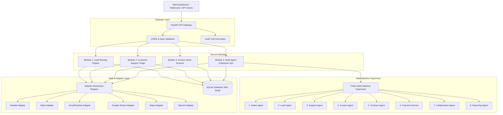

# Enterprise Architecture & System Design

## 1. Architectural Strategy
The Datheon Enterprise AI Automation Suite is engineered around modular domain boundaries, decoupling business logic from external cloud APIs through an abstract adapter architecture.

## 2. Core Modules Architecture

### Module 1: Lead Routing & Instant AI Qualification
- **Intake Pipeline**: Ingests JSON from web forms, webhooks, or CRM systems.
- **Deterministic Scorer**: Evaluates budget tiers (40 pts), company size (30 pts), business need clarity (20 pts), and contact completeness (10 pts).
- **AI Qualification**: Enriches with semantic objection handling, suggested talking points, and confidence estimation.
- **Idempotency Engine**: Hashes `email + company` to guarantee identical requests yield identical results without duplicate syncs.

### Module 2: Autonomous Support & Intelligent Email Triage
- **Sanitizer & Anti-Injection Guardrail**: Neutralizes prompt injection strings and flags sensitive requests (refunds, cancellations, Sev-1 outages).
- **RAG Knowledge Base**: Retrieves approved enterprise policies and SLAs using keyword/token overlap scoring.
- **Grounded Draft Engine**: Produces polite responses strictly adhering to retrieved evidence.
- **Safety Gate**: Default draft-only mode; human approval mandatory to send emails.

### Module 3: AI Vision Invoice Scanner & Accounting Sync
- **File Signature Guard**: Verifies binary magic bytes (`%PDF-`, `\x89PNG`) to prevent executable file uploads.
- **Text & Vision Extraction**: Uses `pypdf` with fallback to OpenAI vision/text parser.
- **Arithmetic Verification**:
  $$\sum (\text{item\_qty} \times \text{unit\_price}) \approx \text{subtotal}$$
  $$\text{subtotal} + \text{tax} - \text{discount} \approx \text{total}$$
  Flags mismatches > $0.05 for human review.
- **Deduplication**: SHA-256 binary hash + composite vendor/invoice number index.

### Module 4: Multi-Agent Enterprise Operations
- **9 Narrow Agents**:
  1. Intake Agent
  2. Lead Intelligence Agent
  3. Support Triage Agent
  4. Invoice Extraction Agent
  5. Contract Preparation Agent
  6. Payment Verification Service
  7. Collaboration Agent
  8. Reporting Agent
  9. Workflow Supervisor
- **Deterministic Stripe Webhook Verification**: Cryptographically validates HMAC-SHA256 signatures with a 300-second replay tolerance window.
- **Reporting Agent**: Aggregates factual metrics directly from SQLite.

## 3. Storage & Persistence
- Local development utilizes SQLite in WAL (Write-Ahead Logging) mode with foreign key enforcement.
- Schema is designed to migrate to PostgreSQL with zero model changes.
